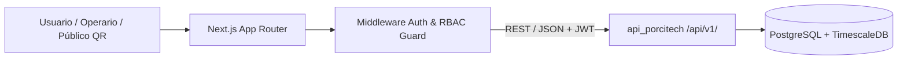

# PorciTech Web — Dashboard Operativo y Portal de Trazabilidad QR

Interfaz web del ecosistema distribuido **PorciTech**, diseñada bajo **Feature-Driven Architecture** para la administración técnica, sanitaria y zootécnica de granjas porcícolas, junto con un portal público de trazabilidad individual mediante códigos QR.

- **Caso de estudio técnico:** [santiagoavirama.dev/proyectos/porcitech](https://santiagoavirama.dev/proyectos/porcitech)
- **Ecosistema PorciTech:**
  - Frontend Web: `porcitech-nextjs` _(este repositorio)_
  - API Core & Series Temporales: [`DevAvirama/api_porcitech`](https://github.com/DevAvirama/api_porcitech)
  - Worker de Visión Artificial: [`DevAvirama/Vision_Artificial`](https://github.com/DevAvirama/Vision_Artificial)
  - App Móvil Offline-First: [`DevAvirama/porcitech_mobile`](https://github.com/DevAvirama/porcitech_mobile)

---

## Arquitectura e Integración



### Decisiones Técnicas Clave

- **Organización por Dominio (_Feature-Driven_):** Aislamiento de módulos de inventario animal, corrales/lotes, sanidad, reproducción, pesajes biométricos y reportes para escalar sin acoplamiento entre vistas.
- **Control de Acceso en Interfaz (RBAC):** Renderizado condicional y protección de rutas alineados con los 3 roles del sistema (`ADMINISTRADOR`, `VETERINARIO`, `OPERARIO`).
- **Trazabilidad Pública Sin Fricción:** Vistas optimizadas para lectura directa desde cámaras móviles al escanear el código QR de cada ejemplar o lote.

---

## Stack Tecnológico

| Capa                       | Tecnologías                                                       |
| :------------------------- | :---------------------------------------------------------------- |
| **Framework & UI**         | Next.js (App Router), React, Tailwind CSS                         |
| **Visualización & Estado** | Componentes analíticos responsivos, Fetch tipado hacia `/api/v1/` |
| **Seguridad & Calidad**    | Gestión de sesión JWT, validación de esquemas en cliente, ESLint  |

---

## Variables de Entorno

Crea un archivo `.env.local` en la raíz a partir de `.env.example`:

| Variable              | Descripción                                    | Ejemplo                        |
| :-------------------- | :--------------------------------------------- | :----------------------------- |
| `NEXT_PUBLIC_API_URL` | URL base del backend `api_porcitech`           | `http://localhost:8000/api/v1` |
| `NEXT_PUBLIC_APP_URL` | URL pública del frontend para generación de QR | `http://localhost:3000`        |

---

## Ejecución Local

```bash
git clone [https://github.com/DevAvirama/porcitech-nextjs.git](https://github.com/DevAvirama/porcitech-nextjs.git)
cd porcitech-nextjs
cp .env.example .env.local
pnpm install
pnpm dev
```

La aplicación quedará disponible en `http://localhost:3000`.
